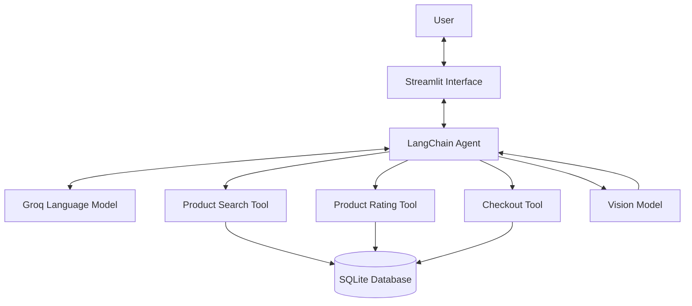

# shopping-agent

A conversational shopping assistant built with **Python, Streamlit, LangChain, Groq, and SQLite**. Ask for products in natural language, filter results by price or organic status, check customer ratings, and place orders. You can also upload a product image to find similar items in the store.

## Features

- **Natural-language shopping:** Describe what you need through a chat interface.
- **Product search and filters:** Search the local catalog by keyword, maximum price, and organic status.
- **Customer ratings:** Retrieve average ratings and review counts from the reviews database.
- **Image-based discovery:** Upload a JPG, JPEG, PNG, or WEBP image to help find similar catalog items.
- **Order placement:** Record orders in the local SQLite database through the agent's checkout tool.

## Architecture



### Request flow

1. The user asks a shopping question or uploads a product image.
2. The LangChain agent determines which available tool can help.
3. Product search retrieves matching products and applies price or organic filters.
4. Rating lookup calculates average ratings and review counts.
5. When requested, the checkout tool records an order.
6. The agent returns its response to the Streamlit interface.

## Technology Stack

| Technology | Purpose |
|---|---|
| Python | Application and tool logic |
| Streamlit | Chat interface and image uploads |
| LangChain | Agent orchestration and tool calling |
| LangChain Groq integration | Connects the application to Groq models |
| Groq | Language-model and image-analysis inference |
| SQLite | Local product, review, and order storage |
| python-dotenv | Loads API credentials from `.env` |

### Models

- **Agent model:** `qwen/qwen3-32b`
- **Vision model:** `meta-llama/llama-4-scout-17b-16e-instruct`

Both models are configured through Groq.

## Getting Started

### Prerequisites

- Python 3.10 or newer
- A Groq API key with access to the configured models

### 1. Clone the repository

```bash
git clone https://github.com/kaziH436/shopping-agent.git
cd shopping-agent
```

### 2. Create a virtual environment

**macOS / Linux**

```bash
python3 -m venv .venv
source .venv/bin/activate
```

**Windows PowerShell**

```powershell
py -m venv .venv
.\.venv\Scripts\Activate.ps1
```

### 3. Install dependencies

```bash
python -m pip install --upgrade pip
python -m pip install streamlit langchain langchain-core langchain-groq python-dotenv
```

### 4. Configure your API key

Create a `.env` file in the repository root:

```dotenv
GROQ_API_KEY=your_groq_api_key_here
```

Replace the placeholder with your own key. **Never commit API keys or other secrets to GitHub.**

### 5. Initialize the database

If the local database needs to be created or initialized, run:

```bash
python setup_db.py
```

Back up any local data you want to keep before rerunning the setup script.

### 6. Launch the application

```bash
streamlit run app.py
```

Open the local URL printed in your terminal to use the shopping assistant.

## Example Prompts

- “Find honey under $15.”
- “Show me organic products under $20.”
- “Find products related to green tea and check their ratings.”
- Upload a product photo and select **Find similar products**.

Available results depend on the contents of the local database and the models enabled for your Groq API key.

## Project Structure

```text
shopping-agent/
├── app.py             # Streamlit interface and chat state
├── shopping_agent.py  # Agent, models, and shopping tools
├── reviews_api.py     # Product rating queries
├── setup_db.py        # Database schema and sample data
├── store.db           # Local SQLite database
├── .env               # Local API credentials (create this yourself)
└── README.md
```

## Key Design Decisions

- **Tool-calling agent:** Lets the model select relevant shopping tools based on the user's request instead of relying on one fixed search sequence.
- **SQLite persistence:** Keeps the project easy to run locally without requiring a separate database server.
- **Separate rating helper:** Keeps review aggregation logic in `reviews_api.py`, separate from the main agent implementation.
- **Separate vision model:** Uses a vision-capable model for image understanding while the primary model handles shopping requests and tool selection.
- **Parameterized SQL queries:** Uses SQL parameters for search filters rather than directly inserting user-provided values into query strings.
- **Environment-based configuration:** Loads API credentials from `.env` instead of hard-coding secrets in source files.

## Troubleshooting

### Groq API errors

- Check that `.env` is in the repository root and contains a valid `GROQ_API_KEY`.
- Confirm that your Groq account has access to the configured models.
- Restart the application after changing environment variables.

### Database errors

- Confirm that `store.db` exists in the repository root.
- Run `python setup_db.py` if initialization is required.
- Back up the database before changing or recreating local data.

## Learning Resource

This project was inspired by the [Codebasics Agentic AI Crash Course using LangChain](https://www.youtube.com/watch?v=D74el9mvNak&list=PLeo1K3hjS3usQGem1bgRLPMpiQcfFn_CG&index=10).
